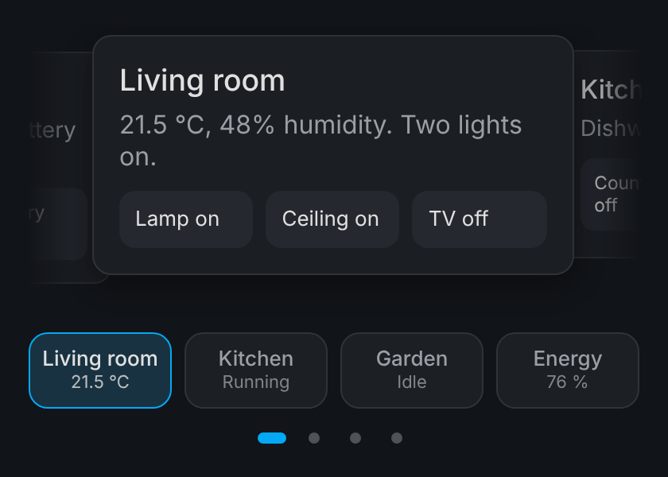
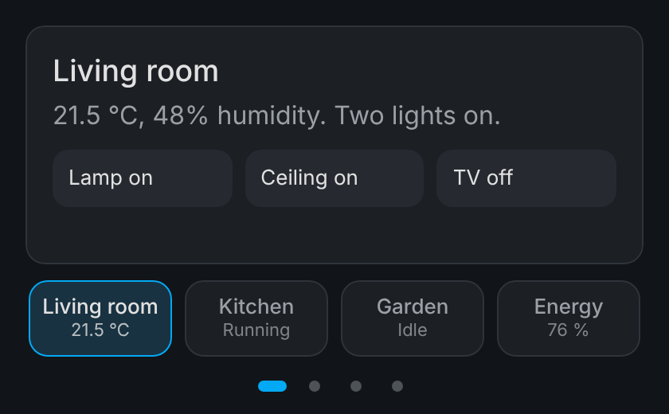

# Deck Card

Put any Home Assistant cards in a swipeable deck. Swipe between them, or tap a named thumbnail to jump straight to one. In coverflow mode the neighbouring cards peek out behind the current one, so it's obvious there is more to swipe to.



It is one small file with no library and nothing to download at run time: the browser's own scroll snapping does the swiping. It comes with a visual editor, so each slide's card is edited in Home Assistant's normal card editor, the way you edit the cards inside a vertical stack.

## Install

**HACS (custom repository).** In HACS, open the three-dot menu → *Custom repositories*, add `https://github.com/githubfreddieve/deck-card` with the type *Dashboard*, then find Deck Card and download it. HACS adds the resource for you; reload the browser (or clear the frontend cache in the app) afterwards.

**By hand.** Copy `deck-card.js` to `/config/www/`, then under *Settings → Dashboards → ⋮ → Resources* add `/local/deck-card.js` as a JavaScript module.

## Use

Add a card and search for *Deck Card*, or in YAML:

```yaml
type: custom:deck-card
effect: coverflow
slides:
  - name: Living room
    icon: mdi:sofa
    entity: climate.living_room
    card:
      type: thermostat
      entity: climate.living_room
  - name: Energy
    icon: mdi:solar-power
    entity: sensor.battery_level
    card:
      type: energy-distribution
```

| Option | Default | What it does |
| --- | --- | --- |
| `slides` | (required) | Two or more slides. Each has a `card` (any card, including stacks and custom cards) and optionally `name`, `icon`, `entity` and `tap_action`. |
| `effect` | `slide` | `slide`: one card fills the width. `coverflow`: the neighbours show behind the current card, smaller and dimmed; tapping one brings it forward. |
| `loop` | `true` | Swiping past the last slide wraps round to the first. |
| `thumbs` | `true` | The strip of named thumbnails under the deck. A thumbnail shows its `entity`'s state under the name. |
| `dots` | `true` | Page dots under the thumbnails. |
| `max_width` | `480` | The widest a slide gets, in pixels; `0` means no limit. On a wide screen the deck stays centred at this size instead of stretching across the dashboard. |
| `corner_radius` | theme | Rounds every slide's corners, in pixels, whatever card is inside (useful for cards that draw square corners, such as power-flow cards). `0` is square; left unset it follows the theme's card radius. |
| `height` | `tallest` | `tallest`: the deck keeps the height of its tallest slide, so the thumbnails never jump. `current`: it follows the slide in view. |

A slide's `tap_action` is a normal Home Assistant action (`more-info`, `navigate`, `perform-action`, a browser_mod pop-up, …) that runs when the slide itself is tapped. It's meant for slides whose card has no buttons of its own.



## Tips

If your dashboard uses a page-swipe plugin such as hass-swipe-navigation, swiping the deck can also flip the page. Turn page swiping off for that dashboard (`swipe_nav: enable: false`); the deck needs the gesture.

The deck respects *reduce motion*: with it on, slides change without animation.

## Compatibility

Developed and tested on Home Assistant 2026.10. The visual editor borrows Home Assistant's own card picker and card editor, which are not a public API. A future Home Assistant release could break the editor; the card itself would keep rendering, and YAML editing always works.

## Licence

MIT
